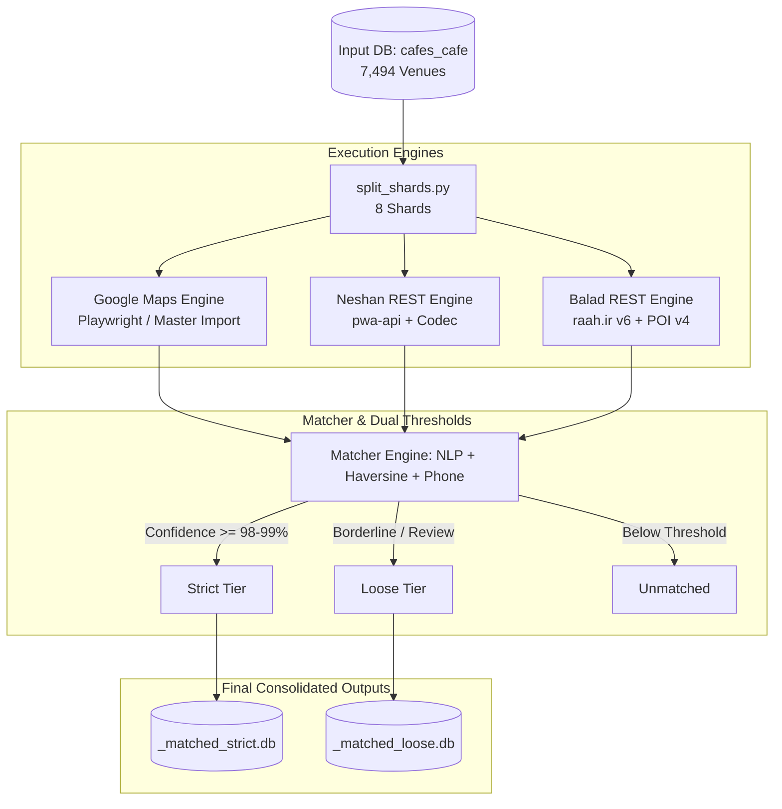

# Matchify: Multi-Platform Map Matching Engine ☕🗺️

[](https://www.python.org/downloads/)
[](https://www.sqlite.org/)
[](LICENSE)

A modular, enterprise-grade matching pipeline designed to match ambiguous cafe and venue databases against **Google Maps**, **Neshan (نشان)**, and **Balad (بلد)** to establish verified locations, canonical identifiers, and accurate coordinates without login requirements or scraping ban risks.

---

## 🌟 Key Architecture & Highlights

- **Tri-Platform Compatibility:**
  - **Google Maps:** Canonical identifiers (`place_id`, `cid`, `fid`, `kgmid`), coordinates, ratings, and phone numbers.
  - **Neshan (نشان):** Ultra-fast REST client for `pwa-api/neshan-search` with automated payload decoding, extracting `crowdId`, title, coordinates, address, and phone numbers.
  - **Balad (بلد):** Lightweight REST client for `search.raah.ir/v6/` with polygon spatial boundaries and secondary POI enrichment (`poi.raah.ir/web/v4`), extracting `poi_token`, title, exact address, and verified phone numbers.
- **Two-Tier Threshold Strategy (Strict vs. Loose):**
  - **⭐ Strict Threshold (~99% Confidence):** Places where identity is beyond doubt. Auto-accepted into `<platform>_matched_strict.db`.
    - *Phone Match:* Verified trailing phone number match + name consistency.
    - *Close Proximity:* Name similarity $\ge 0.85$ within $\le 150\text{m}$.
    - *Exact Title:* Name similarity $\ge 0.95$ within $\le 350\text{m}$.
  - **🔍 Loose Threshold (Human Review Queue):** High-probability candidates with minor transliteration, naming variations, or GPS shifts saved into `<platform>_matched_loose.db` for manual validation:
    - Moderate similarity ($\ge 0.60$) within $500\text{m}$.
    - High similarity ($\ge 0.80$) within extended radius ($1500\text{m}$) to capture city center GPS default shifts.
    - Close proximity ($\le 80\text{m}$) with partial title match ($\ge 0.50$).
- **Zero-Login & Rate-Limit Immune:**
  - Neshan and Balad utilize pure asynchronous HTTP requests with randomized pacing ($0.35\text{s} - 0.70\text{s}$) and exponential backoff, processing 1,000 cafes in under 10 minutes without CAPTCHAs or IP blocks.
  - Google Maps uses Playwright Stealth with context recycling and GDPR cookie pre-seeding.
- **Parallel Sharding & Kaggle-Ready:**
  - Automated sharder (`split_shards.py`) splits 7,494 venues into 8 balanced SQLite shards.
  - Three self-contained Kaggle notebooks (`notebooks/`) allow running shards across parallel Kaggle workers.
  - Merging pipeline (`merge_shards.py`) reconciles shards and separates records into Strict and Loose databases.

---

## 🏗️ Workflow & Pipeline



---

## 📊 Extracted Metadata Fields by Platform

| Field Category | Google Maps | Neshan (نشان) | Balad (بلد) |
|---|---|---|---|
| **Canonical Place ID** | `place_id`, `cid`, `fid`, `kgmid` | `crowd_id` (e.g. `abfcf1e7...`) | `poi_token` (e.g. `6EyBHIB...`) |
| **Verified Coordinates** | `matched_lat`, `matched_lng` | `matched_lat`, `matched_lng` | `matched_lat`, `matched_lng` |
| **Venue Title** | Matched Google Title | Matched Neshan Title | Matched Balad Title |
| **Address** | Formatted Google Address | District & Street Address | Full Postal Address |
| **Phone Number** | Local / International Phone | Verified Landline / Mobile | Verified Contact Phone |
| **Rating & Reviews** | `rating`, `reviews_count` | `rating`, `votes_count` | `rating`, `reviews_count` |
| **Direct Web Link** | `google_maps_url` | `https://neshan.org/maps/places/{id}` | `https://balad.ir/p/{token}` |
| **Match Classification** | `strict`, `loose`, `none` | `strict`, `loose`, `none` | `strict`, `loose`, `none` |
| **Quality Scores** | `name_score`, `dist_m`, `composite` | `name_score`, `dist_m`, `composite` | `name_score`, `dist_m`, `composite` |

---

## 🗂️ Project Structure

```
d:\src\matchify/
├── README.md                          # Documentation and reference guide
├── requirements.txt                   # Project dependencies
├── split_shards.py                    # Shards input DB into 8 Kaggle-ready shards
├── merge_shards.py                    # Merges shard outputs into strict & loose DBs
├── run_matching.py                    # Unified CLI runner for local/shard matching
│
├── src/                               # Core Python library
│   ├── config.py                      # Concurrency, pacing, and platform parameters
│   ├── db.py                          # SQLite ORM, checkpointing, and DB splitting
│   ├── normalizer.py                  # Persian/Arabic text and phone number normalizer
│   ├── matcher.py                     # Multi-tier Strict vs. Loose matching engine
│   └── platforms/                     # Platform search clients
│       ├── base.py                    # BasePlatformClient interface
│       ├── neshan.py                  # Neshan async client (pwa-api + codec)
│       ├── balad.py                   # Balad async client (raah.ir v6 + poi)
│       └── gmaps.py                   # Google Maps adapter
│
├── notebooks/                         # Self-contained Kaggle/Colab notebooks
│   ├── matchify_neshan_kaggle.ipynb   # Modular Kaggle notebook for Neshan
│   ├── matchify_balad_kaggle.ipynb    # Modular Kaggle notebook for Balad
│   └── matchify_gmaps_kaggle.ipynb    # Modular Kaggle notebook for Google Maps
│
├── scripts/                           # Utility scripts
│   ├── export_gmaps_master.py         # Exports Google Maps master into strict & loose DBs
│   ├── build_notebooks.py             # Regenerates notebooks
│   └── kaggle_manager.py              # Kaggle kernel status, download, and orchestration
│
└── data/                              # Database storage
    ├── shards/                        # Generated 8 SQLite shards
    ├── results/                       # Downloaded shard outputs
    └── master/                        # Consolidated strict & loose master databases
        ├── gmaps_matched_strict.db    # 3,976 Strict matches (93.2%)
        ├── gmaps_matched_loose.db     # 289 Loose matches for review (6.8%)
        ├── neshan_matched_strict.db   # Consolidated Neshan strict matches
        ├── neshan_matched_loose.db    # Consolidated Neshan loose matches
        ├── balad_matched_strict.db    # Consolidated Balad strict matches
        └── balad_matched_loose.db     # Consolidated Balad loose matches
```

---

## ⚡ Quickstart Guide

### 1. Sharding the Database

Split the master venue database (`cafochino.db`, 7,494 venues) into 8 balanced shards:

```bash
python split_shards.py --num-shards 8
```

This creates 8 database files in `data/shards/` (`cafochino_shard_01...` to `shard_08...`).

### 2. Running Local Matching

To test or run matching locally for any platform:

```bash
# Run on Neshan (first 50 venues)
python run_matching.py --platform neshan --source-db data/shards/cafochino_shard_01_of_08_937cafes.db --output-db data/results/neshan_shard_01.db --limit 50

# Run on Balad
python run_matching.py --platform balad --source-db data/shards/cafochino_shard_01_of_08_937cafes.db --output-db data/results/balad_shard_01.db --limit 50
```

### 3. Running on Kaggle (Zero-Cost Parallel Processing)

1. Open Kaggle and create a new notebook from `notebooks/matchify_neshan_kaggle.ipynb` or `notebooks/matchify_balad_kaggle.ipynb`.
2. Under **Notebook Options**, set **Internet -> Internet On** and keep **CPU** selected.
3. Attach your shard via **+ Add Input**.
4. Click **Save Version -> Save & Run All (Commit)**.
5. In ~10 minutes, the shard completes and outputs the result SQLite database.

### 4. Merging Shards and Splitting into Strict & Loose Databases

Once all shard runs are downloaded to `data/results/`:

```bash
# Merge Neshan shards
python merge_shards.py --platform neshan --shard-pattern "data/results/neshan_shard_*.db"

# Merge Balad shards
python merge_shards.py --platform balad --shard-pattern "data/results/balad_shard_*.db"
```

The script consolidates all records, displays match statistics, and automatically generates:
- `data/master/<platform>_matched_strict.db`
- `data/master/<platform>_matched_loose.db`

---

## 📈 Current Google Maps Results Summary

The pre-existing Google Maps matching data from `mapify` has already been processed through Matchify's dual-threshold engine via `scripts/export_gmaps_master.py`:

- **Total Venues Processed:** 4,265
- **⭐ Strict Matches (98-99%+ Confidence):** **3,976** (93.2%) $\rightarrow$ `data/master/gmaps_matched_strict.db`
- **🔍 Loose Matches (Human Review Queue):** **289** (6.8%) $\rightarrow$ `data/master/gmaps_matched_loose.db`
- **📞 Phone Number Confirmed Matches:** **597** venues
- **Average Proximity:** 23.6 meters from reported coordinates
